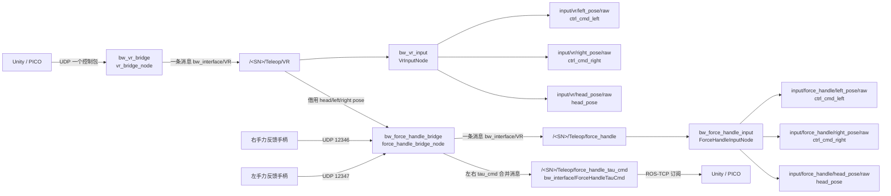

# bw_bringup - Engineering Specification & README

## 1. 概述 (Overview)
`bw_bringup` 是 BlueWorm 遥操作系统的 **顶层启动包**。它不包含任何业务逻辑代码，仅负责系统的统一启动、参数配置加载以及组件容器（Component Container）的编排。

该包通过 `rclcpp_components` 的组合节点容器机制，将 `bw_vr_input`, `bw_teleop`, `bw_core` 等核心模块加载到同一个进程中，以利用 **进程内通信 (Intra-Process Communication)** 实现零拷贝数据传输，显著降低系统延迟。系统容器使用 `component_container_mt` 多线程执行器，避免高频 `smoother_node` 定时输出被同容器内其他回调阻塞，降低发给下位机前的关节目标节奏抖动。当前启动层常驻启动 VR、SDK、文件/Web Action Studio 与统一控制路由链路，`mode` 参数只作为 `control_router_node` 的默认输入源。

---

## 2. 框架与职责边界 (Framework & Boundaries)

### 2.1 核心定位
位于系统的 **部署与集成层 (Deployment & Integration Layer)**。

### 2.2 职责范围 (In-Scope)
- **系统级启动**: 一键启动所有核心节点。
- **组件编排**: 定义哪些组件加载到哪个容器中。
- **进程内通信配置**: 强制开启 `use_intra_process_comms`。

### 2.3 非职责范围 (Out-of-Scope)
- **节点实现**: 不包含任何 C++ 或 Python 源码。
- **参数定义**: 不定义具体节点的参数（参数应由各包自行定义，本包仅负责加载）。

---

## 3. 文件夹结构 (Project Structure)
```text
bw_bringup/
├── launch/                    # 启动文件目录
│   └── system_composition.launch.py # 系统级组合启动脚本
├── package.xml                # 依赖清单
└── CMakeLists.txt             # 构建脚本
```

---

## 4. 启动说明 (Usage)

### 4.1 启动全系统 (Full System)
该命令会启动一个多线程组件容器，并加载 VR 通信、遥操作控制、IK 解算等核心组件。

**注意**: 由于 CasADi 库的多版本依赖问题，启动前必须确保 `LD_LIBRARY_PATH` 包含 `/usr/local/lib`。

```bash
# 建议的启动流程
export LD_LIBRARY_PATH=/usr/local/lib:$LD_LIBRARY_PATH
source install/setup.bash
ros2 launch bw_bringup system_composition.launch.py
```

### 4.2 预期节点结构
启动后，使用 `ros2 node list` 将看到：
- `/<SN>/system_container` (容器节点)
- `/<SN>/vr_bridge_node` (加载在容器内)
- `/<SN>/vr_input_node` (加载在容器内)
- `/<SN>/teleop_component` (加载在容器内)
- `/<SN>/gripper_mode_converter_component` (加载在容器内)
- `/<SN>/arm_command_resolver_node` (加载在容器内，订阅 router 选中的统一手臂命令，解析为 smoother 输入)
- `/<SN>/smoother_node` (加载在容器内，订阅 resolver 输出的 raw 手臂输入)
- `/<SN>/sdk_arm_command_tracker` (独立进程，订阅 SDK 手臂命令状态和下位机反馈，发布 `COMPLETED/TIMEOUT`)
- `/<SN>/control_router_node` (独立进程，统一输入源路由)
- `/<SN>/teleop_input_selector_node` (独立进程，按当前输入源选择 VR/力反馈 raw pose/Joy 进入公共 teleop)
- `/<SN>/robot_command_dispatcher_node` (独立进程，把 router 后统一 `RobotCommand` 适配到现有执行 topic)
- `/<SN>/sdk_input_node` (来自 `bw_sdk_input`，独立进程，SDK 输入适配，常驻；`control_router_node` 仅在 `sdk` 输入源时包装为统一命令)
- `/<SN>/force_handle_bridge_node` (加载在容器内，ESP32 力反馈手柄 UDP 桥接，常驻；`teleop_input_selector_node` 仅在 `force_handle` 输入源时选择其 raw pose/Joy，并发布独立 `tau_cmd` topic 供 Unity/PICO 订阅)
- `/<SN>/force_handle_feedback_node` (加载在容器内，订阅下位机夹爪反馈并 UDP 回发力反馈手柄)
- `/<SN>/force_handle_input_node` (加载在容器内，力反馈手柄原始数据到控制语义映射，并复用 VR 定位/头显输入到 force_handle 源)
- `/<SN>/ros_tcp_endpoint` (独立进程，Unity ROS-TCP 接入；异常退出后由 launch 自动 respawn，避免 VR 重连入口永久丢失)
- `/<SN>/action_recorder_node` (独立进程，VR 菜单动作录制，生成 Web Action Studio 兼容 `.bwaction.zip`)
- `/sn_publisher_node` (独立进程，机器人身份广播节点，固定启动)

其中 `<SN>` 由 `bw_utils.get_robot_sn()` 动态生成（例如 `BW_4TEOGD`）。所有组件节点与独立节点均显式运行在该 namespace 下。
仅 `sn_publisher_node` 例外：该节点运行在全局 namespace，用于多机器人统一发现。

所有组件节点间的 Topics 通信（如 `/<SN>/input/vr/left_pose/raw` -> `/<SN>/Teleop/left_pose/raw` -> `/<SN>/target_left_pose` -> `/<SN>/ctrl/selected_robot_command` -> `/<SN>/ctrl/selected_arm_command`）将自动走共享内存通道（需确保 QoS 兼容）。其中 `input/vr/*` 到 `Teleop/*/raw` 由 `teleop_input_selector_node` 完成，发生在正式 `control_router_node -> ctrl/selected_robot_command` 之前。
此外系统固定发布全局话题 `/sn`（消息 `bw_interface/msg/RobotIdentity`），字段包含机器人 `ip` 与 `sn`。
系统默认还会启动 `/<SN>/remote_wg_agent`（可通过 `remote_agent_enable:=false` 关闭），用于机器人向公网控制面完成首次登记并维护本地 WireGuard 配置；成功登记后不再发送周期心跳。

### 4.3 语音相关参数
`system_composition.launch.py` 新增参数：
- `audio_dir`：预制音频目录。默认空字符串，`bw_voice` 内部将使用默认路径 `~/bw_teleoperate_ws/robot_admin_system/data/audio`。

### 4.4 机器人型号与通讯协议（解耦）

- `robot_version`：机器人型号 `1.0` / `2.0` / `3.0`（默认 `2.0`）。决定滑台默认高度、IK URDF、RViz 模型等机械参数。
- `mantis_protocol_version`：下位机通讯协议 `v1` / `v2` / `v3`（默认 `v1`）。决定串口帧格式、力反馈 `joint_states_fdb_*` topic 等，**与** `robot_version` **独立**。

型号参数集中在 `config/robot_profiles.yaml`，由 `bw_utils.robot_profile` 统一读取和归一化后注入各节点。修改 2 号机滑台高度、3 号机 IK 模型时只改该 YAML，无需在多个 launch 或 Python 模块里同步改解析逻辑。

示例：

```bash
ros2 launch bw_bringup system_composition.launch.py \
  robot_version:=3.0 mantis_protocol_version:=v2
```

### 4.5 公网接入相关参数
- `teleop_params`：Teleop 参数文件路径。默认空字符串，系统会回退到 `bw_core/config/teleop.yaml`。
- `sdk_backend`：`mode:=vr/sdk` 均可使用。`real` 表示真实串口后端，`sim` 表示使用仿真后端 `sdk_sim_backend_node` 替换 `mantis_comm_node`。
- `ee_reset_x` / `left_ee_reset_y` / `right_ee_reset_y` / `ee_reset_z`：可直接在 launch 覆盖左右手初始末端位置。
- `left_ee_reset_qx/qy/qz/qw`、`right_ee_reset_qx/qy/qz/qw`：可直接在 launch 覆盖左右手初始末端姿态四元数。
- `remote_agent_enable`：是否启动 `remote_wg_agent`，默认 `true`。
- `control_plane_url`：控制面 API 基地址，默认 `http://120.26.207.141:5433`。
- `wg_server_public_key`：服务器 WireGuard 公钥（启用代理时必填）。
- `wg_server_endpoint`：服务器 WireGuard 入口（`ip:port`，启用代理时必填）。
- `remote_agent_robot_key`：机器人登录控制面使用的 robot key（联调方便）。
- `remote_agent_robot_key_path`：机器人 robot key 文件路径（推荐）。
- `wg_private_key_path`：机器人私钥路径，默认 `/etc/wireguard/robot.key`。
- `wg_public_key_path`：机器人公钥路径，默认 `/etc/wireguard/robot.pub`（缺失时自动派生）。
- `wg_config_path`：自动写入的 WireGuard 配置路径，默认 `/etc/wireguard/wg0.conf`。
- `wg_apply_mode`：配置应用方式，默认 `systemd`，可选 `systemd/wg-quick/none`。
- `public_endpoint`：机器人公网入口（可选，NAT 场景可留空）。
- `action_recorder_enable`：是否启动 VR 菜单动作录制节点，默认 `true`。
- `action_recorder_action_dir`：动作录制输出目录，默认 `/home/lanchong/BW/bw_teleoperate_ws/robot_admin_system/data/action`。
- `action_recorder_sample_rate_hz`：轨迹录制采样频率，默认 `50.0`。
- `vr_frequency_monitor_enable`：是否启动 VR 控制链路 topic 频率监控节点，默认 `true`。该节点会订阅多路 90Hz/500Hz topic，现场排查时开启；日常遥操作可在 Docker `.env` 中通过 `VR_FREQUENCY_MONITOR_ENABLE=false` 关闭以减少 CPU 干扰。
- `force_handle_bind_ip`：力反馈手柄 UDP bridge 监听地址，默认 `0.0.0.0`。
- `force_handle_joy_max_abs`：力反馈手柄摇杆原始值满量程绝对值，默认 `1000.0`；该参数会注入 `force_handle_bridge_node`，在发布 `Teleop/force_handle` 前把 ESP32 原始摇杆值映射到 `[-1, 1]`。
- `force_handle_right_bind_port`：右手力反馈手柄 UDP bridge 监听端口，默认 `12346`。
- `force_handle_left_bind_port`：左手力反馈手柄 UDP bridge 监听端口，默认 `12347`。
- `force_handle_feedback_target_port`：ESP32 接收 ROS feedback 的 UDP 端口，默认 `8080`。

当 `remote_agent_enable=true` 时，必须提供：

- `remote_agent_robot_key`
  或
- `remote_agent_robot_key_path`

更推荐使用文件路径方式，避免把密钥直接暴露在命令行中。

---

## 5. 依赖关系 (Dependencies)
- `bw_serial`: 提供真实后端 `mantis_comm_node`
- `bw_sdk_input`: 提供正式 SDK 输入适配 `sdk_input_node`
- `bw_file_input`: 提供正式动作文件输入 `file_input_node`
- `bw_action_studio_input`: 提供 Web Action Studio 实时输入适配
- `bw_sim2real`: 可选依赖，仅在 `sdk_backend:=sim` 时提供 SDK 仿真后端 `sdk_sim_backend_node`
- `bw_vr_input`: 提供 `bw_vr_input::VrInputNode`
- `bw_vr_bridge`: 提供 `bw_vr_bridge::VrBridgeNode`
- `bw_force_handle_bridge`: 提供 `bw_force_handle_bridge::ForceHandleBridgeNode` 与 `bw_force_handle_bridge::ForceHandleFeedbackNode`
- `bw_force_handle_input`: 提供 `bw_force_handle_input::ForceHandleInputNode`
- `bw_teleop`: 提供 `bw_teleop::TeleopComponent`
- `bw_core`: 提供正式主链路使用的 `bw_core::ArmCommandResolverNode`、`bw_core::SmootherNode` 和 `sdk_arm_command_tracker`；`bw_core::IKNode` 仅保留为 legacy/调试组件，不在本 launch 加载
- `bw_utils`: 提供 `sn_publisher_node` 与 SN 工具函数
- `bw_remote`: 提供 `remote_wg_agent` 机器人公网接入代理
- `ros_tcp_endpoint`: 提供 VR 模式 TCP Endpoint
- `rclcpp_components`: 提供 `component_container_mt`

## 5.1 输入源路由与执行后端

`mode:=vr/sdk/action_studio/web/file/force_handle/none` 现在只设置 `control_router_node.default_source`，不再决定启动哪些输入节点。`web` 会在 router 内规范化为 `action_studio`。VR 输入链路、SDK 输入适配、力反馈手柄链路、唯一 `smoother_node` 和 `control_router_node` 均常驻启动；其中力反馈手柄 bridge/input/feedback 以 C++ component 加载到 `system_container`；运行时通过 `/<SN>/sys/input_mode` 或 `/<SN>/Teleop/menu/command` 的 `input_mode:<mode>` 切换当前放行源。常驻的 `sdk_input_node` 会接收同一份 `mantis_protocol_version` 参数，并且只在 `mode:=sdk` 时自动调用 `set_ctrl_src`，避免 VR 等其它输入源启动时提前改写下位机控制标志位。

路由前包名命名约定：

| 输入源 | 外部协议接入包 | 路由输入适配包 |
| --- | --- | --- |
| VR | `bw_vr_bridge` | `bw_vr_input` |
| 力反馈手柄 | `bw_force_handle_bridge` | `bw_force_handle_input` |
| SDK | Zenoh 接入合并在 input 包 | `bw_sdk_input` |
| Web Action Studio | FastAPI 后端 | `bw_action_studio_input` |
| 文件动作包 | 无外部协议 bridge | `bw_file_input` |

执行/反馈后端由 `sdk_backend` 决定：

- `sdk_backend:=real`：加载 `bw_serial::MantisCommNode`
- `sdk_backend:=sim`：启动 `bw_sim2real/sdk_sim_backend_node`，节点名仍为 `mantis_comm_node`

力反馈手柄 ROS -> ESP32 feedback 不手动配置反馈 topic，系统只根据已有 `mantis_protocol_version` 自动选择：

| `mantis_protocol_version` | feedback topic |
| --- | --- |
| `v1` | `/<SN>/joint_states_fdb` |
| `v2` | `/<SN>/joint_states_fdb_V2` |
| `v3` | `/<SN>/joint_states_fdb_V3` |

V2/V3 原始串口协议中夹爪是左右臂 `JointMotor7`，但 `bw_force_handle_bridge` 不解析原始字节；它只订阅 `bw_serial` 归一化后的 `JointState`，固定读取 `left_gripper_joint` / `right_gripper_joint` 并分别回发 `position/velocity/effort`。夹爪关节名不作为启动参数暴露。

VR 与力反馈手柄的 router 前链路保持同构：



手臂链路顺序为：`input/vr/*` 或 `input/force_handle/*` raw pose/Joy -> `teleop_input_selector_node` -> `bw_teleop + GripperModeConverter` -> `target_left_pose/target_right_pose` -> `control_router_node` -> `ctrl/selected_robot_command` -> `robot_command_dispatcher_node` -> `ctrl/selected_arm_command` -> `arm_command_resolver_node` -> `ctrl/selected_joint_angle_solution` -> `smoother_node` -> `Teleop/joint_angle_solution/smooth`；SDK 以 `input/sdk/arm_command` 进入 router，Action Studio/file 以 `input/<source>/joint_states` 进入 router。所有来源在 `control_router_node` 后都使用同一个 `ctrl/selected_robot_command`，dispatcher 只是 source-agnostic 兼容适配层，末端 pose 命令统一在 `arm_command_resolver_node` 内调用 ROS 侧 IK，不在 SDK 客户端本地解算，也不再由独立 `IKNode` 为 VR/force_handle 单独解算。SDK 命令若带 `command_id`，router/resolver/tracker 会通过 `sdk/arm_command_status` 依次发布 `ROUTED/RESOLVED/COMPLETED` 或 `FAILED/TIMEOUT`，由 `bw_sdk_input` 转发回 Zenoh `<SN>/sdk/arm_command_status`。切换输入源时 router 会先进入 `none`，向 `Teleop/menu/command` 发布 `system:reset`，复用 `bw_teleop` 的 reset pose 逻辑完成双臂末端复位，短暂复位后再切到目标输入源。复位速度不跟随当前 VR 急速/平滑档：`smoother_node` 会通过 `system/is_resetting` 和 `system/status=SYS_RESET` 临时使用 `bw_core/config/reset.yaml` 的 Ruckig 约束，复位期间收到新的 `MotionProfile` 只缓存为复位后恢复值。VR 菜单可额外向同一菜单 topic 发布 `motion_profile:fast/smooth`，Router 会把急速/平滑两档内置参数转成 `MotionProfile` 并经 `ctrl/selected_motion_profile` 生效；旧版 ROS 会忽略该前缀。`smoother_node` 不再监听输入源状态，也不会按 `vr/sdk/file/action_studio/force_handle` 切换 profile；router 之后的手臂执行链路只看统一命令与显式 `MotionProfile`。

`system_composition.launch.py` 会固定向 `smoother_node` 传入：

| 参数 | 值 |
| --- | --- |
| `input_topic` | `ctrl/selected_joint_angle_solution` |
| `output_topic` | `Teleop/joint_angle_solution/smooth` |
| `motion_profile_topic` | `ctrl/selected_motion_profile` |
| `reset_status_topic` | `system/is_resetting` |

---

## 6. 工程约束 (Compliance)
- **零拷贝**: 必须确保所有组件开启 `use_intra_process_comms=True`。
- **执行器**: 系统容器必须使用 `component_container_mt`，避免高频控制链路定时器与 VR/IK/串口回调在单线程执行器内互相阻塞。
- **异常处理**: 如果某个组件加载失败，整个容器应报错并退出（由 launch 系统管理）。
## 统一控制路由接入

`system_composition.launch.py` 会常驻启动 `bw_control_router/control_router_node`、`teleop_input_selector_node` 和 `robot_command_dispatcher_node`，节点运行在机器人 SN namespace 内。VR、SDK、文件和 Web Action Studio 都在 router 后收敛到同一个 `ctrl/selected_robot_command`。

控制 topic 约定：

| 链路 | Topic |
| --- | --- |
| 输入模式 | `/<SN>/sys/input_mode` |
| Teleop 左手末端目标 | `/<SN>/target_left_pose` |
| Teleop 右手末端目标 | `/<SN>/target_right_pose` |
| VR 左手 raw 位姿 | `/<SN>/input/vr/left_pose/raw` |
| VR 右手 raw 位姿 | `/<SN>/input/vr/right_pose/raw` |
| VR 头显 raw 位姿 | `/<SN>/input/vr/head_pose/raw` |
| VR 手柄输入 | `/<SN>/input/vr/ctrl_cmd_left`, `/<SN>/input/vr/ctrl_cmd_right` |
| VR 头部关节输入 | `/<SN>/input/vr/head_pose` |
| Teleop 夹爪输入 | `/<SN>/input/teleop/gripper_pos` |
| Teleop 底盘输入 | `/<SN>/input/teleop/cmd_vel` |
| 力反馈手柄整包输入 | `/<SN>/Teleop/force_handle` |
| 力反馈手柄 MIT 力矩命令下行给 VR | `/<SN>/Teleop/force_handle_tau_cmd` |
| 力反馈手柄单侧 MIT 力矩命令调试 | `/<SN>/Teleop/force_handle_tau_cmd/left`, `/<SN>/Teleop/force_handle_tau_cmd/right` |
| 力反馈手柄内部源端记录 | `/<SN>/_force_handle/source_endpoint` |
| 力反馈手柄反馈来源 | `/<SN>/joint_states_fdb` / `/<SN>/joint_states_fdb_V2` / `/<SN>/joint_states_fdb_V3` |
| 力反馈手柄左手 raw 位姿 | `/<SN>/input/force_handle/left_pose/raw` |
| 力反馈手柄右手 raw 位姿 | `/<SN>/input/force_handle/right_pose/raw` |
| 力反馈手柄头显 raw 位姿 | `/<SN>/input/force_handle/head_pose/raw` |
| 力反馈手柄 Joy 输入 | `/<SN>/input/force_handle/ctrl_cmd_left`, `/<SN>/input/force_handle/ctrl_cmd_right` |
| 力反馈手柄头部关节输入 | `/<SN>/input/force_handle/head_pose` |
| SDK 手臂统一命令输入 | `/<SN>/input/sdk/arm_command` |
| SDK 手臂命令状态 | `/<SN>/sdk/arm_command_status` |
| Teleop raw 输入选择节点 | `/<SN>/teleop_input_selector_node` |
| Router 选中统一整机命令输出 | `/<SN>/ctrl/selected_robot_command` |
| Dispatcher 手臂 legacy 输出 | `/<SN>/ctrl/selected_arm_command` |
| Dispatcher 动作 profile 输出 | `/<SN>/ctrl/selected_motion_profile` |
| Resolver 解析后的手臂 raw 输出 | `/<SN>/ctrl/selected_joint_angle_solution` |
| SDK 头部输入 | `/<SN>/input/sdk/head_pose` |
| SDK 夹爪输入 | `/<SN>/input/sdk/gripper_pos` |
| SDK 底盘输入 | `/<SN>/input/sdk/cmd_vel` |
| SDK 滑台 jog 输入 | `/<SN>/input/sdk/pelvis_speed` |
| SDK 前后弯腰 jog 输入 | `/<SN>/input/sdk/waist_speed` |
| SDK 滑台绝对高度输入 | `/<SN>/input/sdk/pelvis_height` |
| SDK 滑台最大速度输入 | `/<SN>/input/sdk/pelvis_max_velocity` |
| SDK 前后弯腰绝对角度输入 | `/<SN>/input/sdk/waist_angle` |
| SDK 前后弯腰最大角速度输入 | `/<SN>/input/sdk/waist_max_velocity` |
| Smoother 平滑后的手臂输出 | `/<SN>/Teleop/joint_angle_solution/smooth` |
| Dispatcher 头部 legacy 输出 | `/<SN>/Teleop/head_pose` |
| Dispatcher 夹爪 legacy 输出 | `/<SN>/Teleop/gripper_pos` |
| VR 动作录制状态 | `/<SN>/Teleop/recording/state` |

除全局 `/sn` 之外，控制类 topic 不应再发布到根 namespace。

`force_handle` 模式不新增 IK 节点。VR 手柄固定在力反馈手柄卡槽上时，`bw_force_handle_bridge` 订阅 `Teleop/VR` 借用头显和左右手位姿，并把力反馈按键/摇杆/位置量合成为一条 `Teleop/force_handle` 整包；`bw_force_handle_input` 再像 `bw_vr_input` 一样拆出 `input/force_handle/left_pose/raw`、`input/force_handle/right_pose/raw`、`input/force_handle/head_pose/raw`、`input/force_handle/ctrl_cmd_left`、`input/force_handle/ctrl_cmd_right` 和 `input/force_handle/head_pose`。`teleop_input_selector_node` 先选择 `vr` 或 `force_handle` 的 raw pose/Joy 进入公共 `bw_teleop + GripperModeConverter`，再由 `control_router_node` 把生成的 `target_left_pose/target_right_pose` 包装进 `ctrl/selected_robot_command`，由 dispatcher 拆为 `ctrl/selected_arm_command` 后交给唯一 `arm_command_resolver_node` 求解。

## VR 菜单动作录制

系统默认启动 `bw_action_recorder/recording_node`，节点名为 `action_recorder_node`。Unity 菜单通过现有 `/<SN>/Teleop/menu/command` 发布 `recording:*` 命令，录制节点订阅最终 `Teleop/joint_angle_solution/smooth`、`Teleop/head_pose` 和 `Teleop/gripper_pos`，生成与 Web Action Studio 一致的 `.bwaction.zip` 包并刷新 `robot_admin_system/data/action/actions.json`。

支持命令：

| 命令 | 说明 |
| --- | --- |
| `recording:mode:keyframe` | 开启关键点录制模式 |
| `recording:capture_keyframe` | 记录当前最终关节快照 |
| `recording:mode:trajectory` | 开启轨迹录制模式 |
| `recording:start` | 开始轨迹录制 |
| `recording:stop_save` | 停止并保存动作包 |
| `recording:cancel` | 取消当前录制 |
| `recording:mode:off` | 关闭录制模式 |
